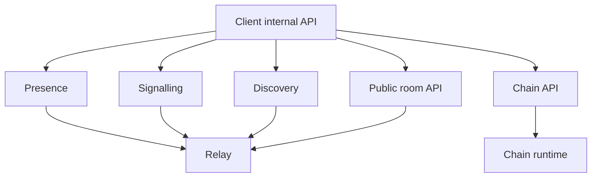

# APIs and services

Interfaces are separated so implementations can evolve independently.

## Chain API

```text
register_username
resolve_username
get_identity_root
publish_relay_record
list_relays
get_protocol_parameters
```

## Presence API

```text
publish_presence_lease
query_presence
subscribe_presence
remove_presence
```

## Signalling API

```text
create_session_offer
send_session_answer
publish_transport_candidate
request_relay_path
close_session
```

## Discovery API

```text
publish_discovery_profile
remove_discovery_profile
search_by_interest
search_by_language
search_nearby
find_mutuals
request_random_match
publish_group_listing
search_groups
```

## Public room API

```text
subscribe_room
unsubscribe_room
publish_room_event
fetch_recent_room_events
announce_room_peer
```

## Client internal API

```text
send_message
retry_outbound_message
acknowledge_delivery
create_group
add_group_member
remove_group_member
send_group_message
join_room
leave_room
send_attachment
sync_device_history
```



## Local daemon control API v1

`startLocalDaemon` in `@nexnet/client` runs a Bun HTTP service bound only to
`127.0.0.1`. This is a privileged transport-control API, not an agent execution
service. The SDK is `LocalNexnet` from `@nexnet/client/local-sdk`; that entry
imports no device storage, signing keys or Bun server code.

Every route requires `Authorization: Bearer TOKEN`, including status. The token
is a host-provided random 32-byte value encoded as 64 lowercase hex characters.
The daemon rejects reuse of the database unlock key as the control token.
Tokens in query strings are not accepted. Browser-origin requests and requests
with a different Host header are rejected. There is no CORS or remote binding
option. Responses disable caching. The SDK rejects redirects and non-loopback
origins rather than forwarding its token.

| Method | Route                     | Result                                                                                                    |
| ------ | ------------------------- | --------------------------------------------------------------------------------------------------------- |
| GET    | `/v1/status`              | Identity, device, authenticated connection status, certificate expiry and a transport-error flag          |
| POST   | `/v1/messages`            | `{peer, text}` becomes an encrypted durable outbox entry; HTTP 202 returns `{messageId, state: "queued"}` |
| GET    | `/v1/messages/:messageId` | `queued` or `delivered`, based on the durable queue and verified receipt-v2 contract                      |
| GET    | `/v1/inbox`               | A non-destructive snapshot of the durable inbox, with message IDs for caller-side deduplication           |
| GET    | `/v1/presence/:peer`      | Relay-observed `online: true`, `false`, or `null` when evidence is unavailable                            |

Successful JSON responses contain `{version: 1, data: ...}`. Errors contain
`{version: 1, error: {code: ...}}`. Authentication failures return 401, forbidden
peers return 403, malformed messages return 400, and transport failures return 503. Provider errors, key material and host paths are not returned over HTTP.
`status.transportError` records whether a transport error occurred since this
daemon started; it does not claim that an application task failed.

Messages are nonempty text of at most 4096 UTF-8 bytes. Unknown message fields
are rejected, and request bodies are limited to 16 KiB. A send response does
not imply delivery. `delivered` means verified durable recipient storage, not
accepted or completed execution. SDK timeouts and lost responses can leave an
ambiguous send result. The SDK does not retry automatically: durable request
idempotency, correlation, deadlines and execution errors belong to the next
piece. The inbox currently returns the complete allowed-peer snapshot;
pagination, quotas, backpressure and retention remain later work.

### Host ownership and trusted peers

`LocalDaemonConfig.loadDevice()` obtains `PersistentClientConfig` from a
host-owned secret provider and explicitly selects `mode: "open"` or
`mode: "create"`. Creation additionally requires `DeviceCredentials` containing
only device authority. The existing `renewDeviceCertificate` callback returns
a principal-signed certificate, never a principal root key. The host signer
still owns principal authorisation checks; HTTP callers cannot provision
devices, change the signer, renew arbitrary certificates, or retrieve keys.

`loadControlToken()` supplies the independent control token. The host-only
`readOsSecret32({service, name})` helper reads a pre-provisioned hex secret using
`Bun.secrets`: macOS Keychain, Linux Secret Service, or Windows Credential
Manager. Missing, malformed or unavailable secrets reject startup without
environment, file or generated-key fallback. A host can instead use another
secret provider through the callbacks. The daemon does not create or modify
OS credentials, and a compromised host can still read the keys and inbox.

`trustedPeerRoots` pins principal public keys. Identity IDs are derived from
those keys, not accepted as claims. Both sends and inbound DM processing
require membership. Disallowed inbound messages are rejected before prekey
lookups, ratchet updates, inbox insertion or acknowledgement. Narrowing the
allowlist while a disallowed peer has pending outbound messages rejects startup,
including messages waiting for backoff. Nothing is silently deleted or sent
under the old policy.

The daemon owns the encrypted device store for its entire lifetime. It waits
for relay authentication before opening the control listener. `close()` stops
new HTTP requests, drains active requests, then closes the client and releases
ownership. Start or restart failures leave the store intact. A host launcher
owns process supervision and OS service installation; neither is automatic.

### Implementation boundary

#9 supplies renewal and transport reception. #10 supplies verified root-free
receipts. #11 supplies crash-safe recovery with single-writer ownership. The
local daemon and SDK add privileged transport control, not receiver-verifiable
grants, bounded execution authority or a usable delegated-agent daemon. The
control token permits reading this device's allowed-peer inbox and sending to
all configured peers; it is not suitable for distribution to untrusted jobs.
Revocation remains open as #4. Certificate renewal does not revoke a stolen
credential. Accepted, completed and failed execution are not inferred from
queued or delivered transport states. A2A remains an optional future HTTP
adapter at agent endpoints, not an A2A-over-Nexnet binding.
