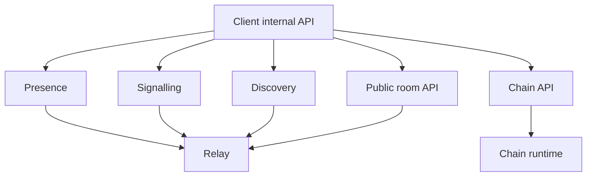

# APIs and services

Interfaces are separated so implementations can evolve independently.

## Chain API

```text
register_username
resolve_username
get_identity_root
publish_relay_record
list_relays
get_protocol_parameters
```

## Presence API

```text
publish_presence_lease
query_presence
subscribe_presence
remove_presence
```

## Signalling API

```text
create_session_offer
send_session_answer
publish_transport_candidate
request_relay_path
close_session
```

## Discovery API

```text
publish_discovery_profile
remove_discovery_profile
search_by_interest
search_by_language
search_nearby
find_mutuals
request_random_match
publish_group_listing
search_groups
```

## Public room API

```text
subscribe_room
unsubscribe_room
publish_room_event
fetch_recent_room_events
announce_room_peer
```

## Client internal API

```text
send_message
retry_outbound_message
acknowledge_delivery
create_group
add_group_member
remove_group_member
send_group_message
join_room
leave_room
send_attachment
sync_device_history
```



## Local daemon control API v1

`startLocalDaemon` in `@nexnet/client` runs a Bun HTTP service bound only to
`127.0.0.1`. This is a privileged transport-control API, not an agent execution
service. The SDK is `LocalNexnet` from `@nexnet/client/local-sdk`; that entry
imports no device storage, signing keys or Bun server code.

**Keep the control token out of untrusted jobs.** It permits reading this
device's allowed-peer inbox and sending to every configured peer. Keep it in
the principal's trusted controller, not in job environments, container images
or model context. A job-facing API requires scoped grant enforcement, which is
not implemented. Loopback binding does not reduce the token's authority.

Every route requires `Authorization: Bearer TOKEN`, including status. The token
is a host-provided random 32-byte value encoded as 64 lowercase hex characters.
The daemon rejects reuse of the database unlock key as the control token.
Tokens in query strings are not accepted. Browser-origin requests and requests
with a different Host header are rejected. There is no CORS or remote binding
option. Responses disable caching. The SDK rejects redirects and non-loopback
origins rather than forwarding its token.

| Method | Route                     | Result                                                                                                    |
| ------ | ------------------------- | --------------------------------------------------------------------------------------------------------- |
| GET    | `/v1/status`              | Identity, device, authenticated connection status, certificate expiry and a transport-error flag          |
| POST   | `/v1/messages`            | `{peer, text}` becomes an encrypted durable outbox entry; HTTP 202 returns `{messageId, state: "queued"}` |
| GET    | `/v1/messages/:messageId` | `queued` or `delivered`, based on the durable queue and verified receipt-v2 contract                      |
| GET    | `/v1/inbox`               | A non-destructive snapshot of the durable inbox, with message IDs for caller-side deduplication           |
| GET    | `/v1/presence/:peer`      | Relay-observed `online: true`, `false`, or `null` when evidence is unavailable                            |

Successful JSON responses contain `{version: 1, data: ...}`. Errors contain
`{version: 1, error: {code: ...}}`. Authentication failures return 401, forbidden
peers return 403, malformed messages return 400, and transport failures return 503. Provider errors, key material and host paths are not returned over HTTP.
`status.transportError` records whether a transport error occurred since this
daemon started; it does not claim that an application task failed.

Messages are nonempty text of at most 4096 UTF-8 bytes. Unknown message fields
are rejected, and request bodies are limited to 16 KiB. A send response does
not imply delivery. `delivered` means verified durable recipient storage, not
accepted or completed execution. SDK timeouts and lost responses can leave an
ambiguous send result. The SDK does not retry automatically: durable request
idempotency is available through the agent-envelope routes below, not the raw
text-send route. The inbox returns the complete allowed-peer snapshot;
pagination remains later work. Resource limits and retention are described below.

### Host ownership and trusted peers

`LocalDaemonConfig.loadDevice()` obtains `PersistentClientConfig` from a
host-owned secret provider and explicitly selects `mode: "open"` or
`mode: "create"`. Creation additionally requires `DeviceCredentials` containing
only device authority. The existing `renewDeviceCertificate` callback returns
a principal-signed certificate, never a principal root key. The host signer
still owns principal authorisation checks; HTTP callers cannot provision
devices, change the signer, renew arbitrary certificates, or retrieve keys.

`loadControlToken()` supplies the independent control token. The host-only
`readOsSecret32({service, name})` helper reads a pre-provisioned hex secret using
`Bun.secrets`: macOS Keychain, Linux Secret Service, or Windows Credential
Manager. Missing, malformed or unavailable secrets reject startup without
environment, file or generated-key fallback. A host can instead use another
secret provider through the callbacks. The daemon does not create or modify
OS credentials, and a compromised host can still read the keys and inbox.

**The real OS Keychain path is untested.** Current tests stub `Bun.secrets.get`;
they prove validation and failure propagation, not native credential access.
A real macOS check requires permission to create, read and delete disposable
Keychain entries in the daemon user's login session, using the deployment Bun
runtime. Separate entries must supply the unlock key and control token. The
check must start the daemon with those readers, persist a message, restart in
a new process and recover it. Missing or malformed entries and an unavailable
or locked credential store must fail without a fallback. The test must not
print secrets, and must remove its entries and disposable database afterward.
Headless service access and any Keychain approval prompts must be checked in
the actual service account context, not inferred from an interactive shell.

`trustedPeerRoots` pins principal public keys. Identity IDs are derived from
those keys, not accepted as claims. Both sends and inbound DM processing
require membership. Disallowed inbound messages are rejected before prekey
lookups, ratchet updates, inbox insertion or acknowledgement. Narrowing the
allowlist while a disallowed peer has pending outbound messages rejects startup,
including messages waiting for backoff. Nothing is silently deleted or sent
under the old policy.

The daemon owns the encrypted device store for its entire lifetime. It waits
for relay authentication before opening the control listener. `close()` stops
new HTTP requests, drains active requests, then closes the client and releases
ownership. Start or restart failures leave the store intact. A host launcher
owns process supervision and OS service installation; neither is automatic.

### Implementation boundary

#9 supplies renewal and transport reception. #10 supplies verified root-free
receipts. #11 supplies crash-safe recovery with single-writer ownership. The
local daemon and SDK add privileged transport control, not receiver-verifiable
grants, bounded execution authority or a usable delegated-agent daemon. The
control token permits reading this device's allowed-peer inbox and sending to
all configured peers; it is not suitable for distribution to untrusted jobs.
Revocation remains open as #4. Certificate renewal does not revoke a stolen
credential. Accepted, completed and failed execution are not inferred from
queued or delivered transport states. A2A remains an optional future HTTP
adapter at agent endpoints, not an A2A-over-Nexnet binding.

## Agent envelopes v1: delivery is not execution

The privileged controller can exchange versioned `request`, `result` and
`error` envelopes over the existing authenticated, encrypted DM transport.
This adds lifecycle records, **not a job executor or permission to execute**.
The same control-token and trusted-peer restrictions above apply. Do not give
these SDK methods or their token to untrusted jobs. Grants remain unimplemented.

| Method | Route                                     | SDK method                       | Purpose                                                                   |
| ------ | ----------------------------------------- | -------------------------------- | ------------------------------------------------------------------------- |
| POST   | `/v1/agent/requests`                      | `submit(peer, request)`          | Durably queue a request or return the original request's state            |
| GET    | `/v1/agent/requests/:peer/:correlationId` | `execution(peer, correlationId)` | Separate transport and peer-reported execution states                     |
| GET    | `/v1/agent/inbox`                         | `agentInbox()`                   | Requests and explicit rejected-message records                            |
| POST   | `/v1/agent/admit`                         | `admit(peer, correlationId)`     | Record admission or reject expired new admission                          |
| POST   | `/v1/agent/respond`                       | `respond(peer, resultOrError)`   | Reject admission, or record completion or execution error after admission |

POST bodies are `{peer, envelope}`, except admission's `{peer, correlationId}`.
Each envelope has `version: 1`, `kind`, and `correlationId`. Requests additionally
have `capability`, `acceptBefore` (Unix milliseconds) and JSON `input`. Results
have `status: "accepted"`, or `status: "completed"` with JSON `value`. Errors
have `stage: "admission" | "execution"`, `code` and `message`. Unknown versions,
fields, invalid variants, non-JSON values, nesting beyond 12 levels and envelopes
over 4096 UTF-8 bytes are rejected. Correlation IDs use 1–128 ASCII letters,
digits, underscores or hyphens; controllers should generate at least 128 random
bits and persist the ID before submitting. Capability names are identifiers,
not verified capabilities or grant checks.

The outer DM remains CDE-encoded and device-authenticated. Envelope JSON is
inside its encrypted application payload (`contentType: "agent"`); it is not
a separate signature format. Identity comes from the verified DM sender, never
from an envelope's claimed sender. Request equality uses canonical CDE bytes,
so JSON object key order does not create a conflict.

### Admission deadlines do not bound execution

`AgentOutgoing.transport.state` is `queued | delivered`. Separately,
`execution` is one of:

- `{state: "awaiting_evidence"}`: no execution evidence yet, **not failure**.
- `{state: "accepted", outcome: "not_reported"}`: admitted, outcome unknown,
  **not failure and never permission to re-execute**.
- `{state: "completed", result}`: an explicit peer report of completion.
- `{state: "failed", error}`: an explicit peer admission or execution error.

Transport receipts only prove durable storage. There is no generic `unknown`
failure variant and no automatic execution retry. `acceptBefore` only prevents
**new admission** at or after the receiver's local wall-clock deadline. Admission
is checked again at the transaction commit, including after slow certificate or
bundle preparation. An expired request receives `admission_expired`, not a claim
that accepted work was cancelled. Clock synchronisation is the host's concern.

Once accepted, crossing that deadline leaves the state accepted with unknown
outcome until an explicit result or error arrives. Late evidence still counts;
reordered admission evidence cannot regress a terminal outcome. Conflicting
terminal evidence is rejected and exposed in `agentInbox()`, not overwritten.
A hard completion deadline or cancellation guarantee requires executor
cooperation and a cancellation protocol; neither is provided here.
The trusted controller can report an admission error before acceptance, such
as an unsupported capability. An admission error cannot undo accepted work;
only explicit execution evidence can settle its outcome.

### Durable idempotency is not exactly-once side effects

Incoming deduplication is scoped to the authenticated principal sender plus
correlation ID, including messages from different sender devices, within one
receiving device's store. The closed pilot requires one admitting device per
principal endpoint: independent receiving devices do not share admission records
and cannot promise cross-device deduplication. Outgoing records are scoped to recipient plus
correlation ID in this device's store. An identical repeated submission returns
the original message ID and state, even after restart. Changed content under the
same ID returns `correlation_conflict` (HTTP 409); conflicting inbound messages
are durable `rejected` entries rather than merged requests. Errors and results
must match the original authenticated recipient and correlation ID.

Admission returns `kind: "new_admission"` only for the operation that durably
commits acceptance; its type guarantees accepted state. Repeated/concurrent
admission or recovery returns `kind: "existing_decision"`, **never a new work
claim**. No work starts automatically. A trusted external executor must enforce
grants separately before executing anything. Do not treat admission as a grant.

Ratchet advancement, immutable response/request outbox and associated lifecycle
record commit in one encrypted SQLite transaction. Authenticated inbox messages
are replayed into lifecycle records with transactional processed markers, so a
crash between transport reception and application observation does not lose work.
Accepted state commits with its response before the HTTP admission reply. A crash
after that commit but before execution can therefore strand accepted work with
unknown outcome. Recovery must reconcile it, not execute it again. No atomicity
with external side effects or exactly-once execution is claimed.

Idempotency records have no automatic expiry. Transport body compaction below
preserves replay evidence; never delete deduplication records while their IDs
could be replayed. AD-25's compromised-host and old-snapshot
limitations still apply. Native Keychain round-trip remains untested as described
above. The stack is #9 renewal/reception, #10 verified root-free receipts, #11
crash-safe recovery/single-writer ownership, #12 privileged local daemon/SDK,
and these envelopes. It is still not a usable delegated-agent execution service:
receiver-verifiable grant enforcement is missing, revocation remains #4, and
delivery is not execution.

## Capability advertisements are signed claims

`LocalNexnet.advertise(peer, capabilities, ttlMs?)` publishes a device-signed
self-description through encrypted DMs to a pinned trusted peer. The authenticated
local route is `POST /v1/agent/capabilities` with `{peer, capabilities, ttlMs}`.
Each capability has a `name` and `description`. `capabilities(name?)` queries
`GET /v1/agent/capabilities?capability=NAME` locally, without fetching remote URLs.

Results carry `evidence: "signed_self_description"`. A signature proves who made
the claim, **not competence, authority or permission to execute**. There is no
reputation eligibility gate, global/open-network index, automatic job routing,
grant enforcement, or A2A binding. Empty search results mean no current claim,
not evidence that a peer lacks a capability. An empty signed capability list
withdraws previous descriptions; it does not revoke credentials or grants.

Advertisements use version 1 and the existing domain-separated identity proof
with operation `agent.capabilities.v1`. A valid device certificate is required;
root-only proofs are rejected. The verifier pins the principal root, checks the
claimed identity against both proof and authenticated DM sender, and bounds
advertisement validity by certificate validity. Claims expire after at most one
hour, with the default also one hour. Expired claims and certificates disappear
from results without becoming negative reputation evidence.

There are at most 16 unique capability names per advertisement. Names use the
request-envelope capability syntax; descriptions are at most 160 UTF-8 bytes.
The signed JSON body is limited to 8192 UTF-8 bytes. Unknown fields, versions,
malformed certificates, future timestamps and invalid signatures are rejected.
Each inbox/cached record is parsed and verified independently; one hostile or
malformed record cannot abort lookup or replace a valid peer's advertisement.

The index retains one current claim and a monotonically increasing revision
watermark per pinned principal. Older or equal revisions cannot replace it,
including after expiry or restart. Publication revisions commit atomically with
ratchet and outbox state. Revision continuity requires recovering the same device
store; replacing it needs an explicit future revision-reset protocol. AD-25's
old-snapshot limits remain. The index exposes claims only to the privileged
controller; relays do not retain private capability bodies. Trusted peers learn
the advertised names/descriptions, signer device, revision and validity window.

**Multiple receiving devices can duplicate execution.** Two independent device
stores for the same principal can each admit the same sender/correlation ID.
The sender cannot distinguish those admissions, so duplicate admission can cause
double execution. The pilot requires one admitting device per principal endpoint;
single-writer locking protects one store, not independent stores. This limitation
also appears in PR #13, not just deployment instructions.

## Resource limits reject work without deleting obligations

The daemon applies these host-configured defaults on every start:

| Limit                                                    | Default                   |
| -------------------------------------------------------- | ------------------------- |
| Logical encrypted row bytes, including names/nonces/tags | 64 MiB                    |
| Stored records, including replay evidence                | 20,000                    |
| Pending outgoing messages                                | 256 total, 64 per peer    |
| Incoming messages with retained bodies                   | 1,024 total, 256 per peer |
| Simultaneous authenticated HTTP requests                 | 8                         |
| Disposable transport body retention                      | 24 hours                  |

`LocalDaemonConfig.limits` overrides the storage/queue/inbox/retention defaults;
`maxConcurrentRequests` overrides concurrency. All limits are positive safe
integers. They are host policy, not remote grant budgets. Bare persistent-client
callers must explicitly call `configureLimits`; daemon defaults do not silently
change every library caller. Status exposes logical usage and configured limits.

HTTP requests over the concurrency limit return 429 `busy` immediately instead
of joining an unbounded application queue. New writes exceeding capacity return
429 `capacity_exhausted`. SDK errors carry those codes and do not auto-retry.
Neither response reports failed execution. Pending counts include backoff-delayed
messages. Incoming capacity checks occur in the same transaction as inbox/key
state: refusal neither advances ratchets nor consumes prekeys, and sends no
delivery receipt. The sender keeps its immutable envelope for a later retry.
Per-peer limits prevent one peer from consuming every message slot, but the
global byte/record budget remains shared and does not guarantee fairness.

Retention runs on startup and traffic. After the local retention age, delivered
outbox ciphertext is compacted only when a persisted verified receipt exists.
Raw text inbox bodies and already-indexed capability transport bodies are
compacted using local `receivedAt`, never an untrusted sender timestamp.
`LocalInboxMessage.contentExpired: true` distinguishes removed content from an
originally empty body. Identity/message metadata and receipt proofs remain so
duplicates still acknowledge without being displayed or executed again.
Legacy inbox entries without local receipt time are retained, not guessed old.

Pending deliveries, all agent request/result/error bodies, accepted work,
idempotency records and capability revision watermarks are **never aged out**.
The total record/byte budget bounds their growth instead. Reaching that budget
can also prevent new acknowledgements or completion reports from committing;
the operation rolls back and requires host intervention. There is no automatic
eviction, reset or silent success. A closed pilot is finite-capacity, not an
indefinitely running archive. The host can increase limits after inspecting
usage; safe deletion of execution history requires a future replay-horizon and
compaction protocol. Do not delete old IDs to make space.

These budgets measure logical encrypted rows, not SQLite file size, free disk,
ratchet CPU time or OS resource reservation. SQLite journal/free pages and host
snapshots can retain old ciphertext. Compaction is not secure erasure and does
not promise physical disk reclamation. Hard disk/CPU isolation belongs to the
host. No new grant, execution, cancellation or revocation guarantee is added.

### Pilot in plain language

A trusted controller can keep a device identity alive without handing jobs the
principal root key, exchange encrypted messages with allowlisted peers, recover
its keys/inbox/outbox after restart, and verify delivery using certified devices.
It can exchange correlated requests, record admission and explicit outcomes, and
look up signed capability claims. Replays, conflicts, deadlines and capacity
refusals have explicit outcomes. One process owns each device store.

It cannot safely hand its all-powerful control token to untrusted jobs. It does
not enforce delegated grants or execute jobs, verify competence, guarantee
completion/cancellation/exactly-once side effects, or coordinate admission across
independent receiving devices. Delivery is storage, not execution. Revocation is
still #4; a compromised host can read its secrets, and old-snapshot rollback is
not detected. Real OS Keychain integration remains untested. The network/chain
is still the development foundation described by this repository, not a shipped
open-network agent service.
