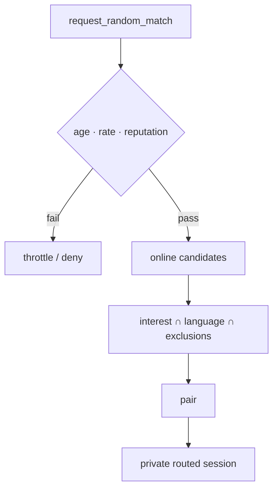

# Discovery

Multiple discovery systems. Private contact graphs must not be uploaded in
plaintext.

Profile upserts accept only identity proof fields, username (1–32 characters),
optional bio (truncated to 160), and optional interests/languages (up to 16
non-empty strings of at most 32 characters each). Unknown fields, including
client-supplied online state, reputation and creation dates, are rejected;
malformed legacy profiles are skipped on load.

Public profiles expose only identityId, username, bio, interests, languages and
online. Online state comes from the relay's authenticated connection table via
the optional `RELAY_SERVICE` binding (`GET /online/:identityId`), never from a
profile publication or signed freshness claim. Missing/unavailable/invalid
relay evidence yields `online: null` (unknown), not an asserted offline state;
random matching requires an explicit `online: true`. No last-seen is exposed.

## Interest discovery

Users select interests from freeform tags, canonical tag IDs, public room
membership, or local preferences.

First implementation: **canonical normalised tags**.

```text
software.rust
music.experimental
photography.street
language.cantonese
```

## Mutual discovery

May derive from:

- direct contact graph intersections
- shared group membership
- shared chatroom participation

First implementation may limit mutuals to explicit shared groups and rooms.

## Nearby discovery (AD-19)

Optional and opt-in. **Post-MVP only** — not in first ship.

No precise coordinates. Coarse cells only (venue / ~1 km / suburb / city).

Location records must:

- expire quickly
- be unlinkable where possible
- never appear on-chain
- be hidden by default

## Language discovery

Users may specify:

- languages spoken
- preferred conversation languages
- optional proficiency

Matching prioritises shared preferred conversation languages.

## Link discovery

Links may resolve to:

- profile
- public chatroom
- private group invitation
- direct chat request
- random matching pool

## Group discovery

Discoverable groups may publish:

- group ID, name, description
- language, interest tags
- join policy
- approximate size

Private groups not publicly indexed unless explicitly enabled.

## Random matching

Combines:

- current online state
- interests
- language
- optional location
- reputation threshold
- exclusion lists
- recent-match avoidance

Random sessions use **private routed mode** by default.



See [reputation.md](reputation.md) and [transport.md](transport.md).
