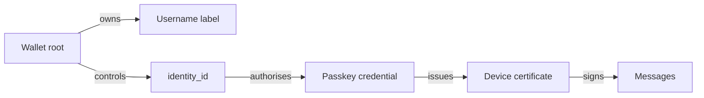

# Identity

## Account root

Each account has a root identity controlled by a wallet.

The wallet address is the account's 32-byte Ed25519 root signing public key.
It verifies device certificates; device keys, not the wallet key, sign messages.

The wallet is final authority over:

- username ownership
- account identity
- passkey registration
- device authorisation
- account recovery

Accounts are not recoverable without the wallet or credentials the wallet
explicitly authorised.

### Recovery (AD-16)

- **Wallet / root key** is ultimate recovery authority.
- A **passkey registered by the wallet** may re-authenticate devices and
  renew certificates without exporting the root key every time.
- Passkey alone cannot change root authority unless the wallet previously
  authorised that capability.
- Lost wallet without backup = lost account control.

## Username vs identity

Usernames are:

- globally unique
- first come, first served
- free to register at the application layer
- non-transferable after registration
- **not** the user's cryptographic identity

A username is a mutable label owned by a wallet.

Stable identity is a cryptographic identity identifier.

```text
username: @max
identity_id: nexnet1abc...
wallet_address: ntl1xyz...
```



Messages remain tied to the signing identity rather than the username label.

## Username reservation semantics

- one active owner at a time **per username**
- **AD-10:** each wallet / identity_id may **own at most one username at a time**
- transfers disabled to prevent squatting and flipping
- historical messages preserve signing identity
- operators cannot silently reassign names
- prohibited / reserved names defined at genesis or transparent governance
- **no** hardware / device mint lock (breaks multi-device, CLI, privacy)

### Anti-spam (AD-10)

```text
max owned per identity: 1
create: free, FCFS, unique
create rate: limited (see consensus / chain params; e.g. 1 create / 24h)
transfer: disabled
hardware binding: none
```

Speculators can still use many wallets. Honest users cannot hoard many names
on one account. Device attestation is not a registration requirement.

## Passkeys

Users authenticate with passkeys.

Passkeys authorise short-lived client sessions and device keys.

The wallet records a signed commitment to each passkey credential. The
commitment binds the credential ID, COSE public key, relying-party ID, and
origin to the identity. A fresh assertion over a single-use, certificate-bound
challenge authorises a device certificate; the chain records that result and
advances the authenticator counter. Receivers resolve that recorded certificate
when it is not independently root-signed.

Authority chain:

```text
wallet/root authority
  -> authorises passkey credential
    -> authorises short-lived device certificate
      -> authorises messaging session keys
```

The wallet should **not** sign every chat message.

## Device keys

Each device generates its own device signing and encryption keys.

The account root may authorise the device through a signed certificate. A
wallet-authorised passkey may also authorise it through the recorded assertion
flow above.

Suggested certificate fields:

```text
device_certificate {
  account_id
  device_id
  device_signing_public_key
  device_encryption_public_key
  issued_at
  expires_at
  capabilities
  root_signature
}
```

Product direction: no complex user-facing device revocation UI in v1.

### Session policy (AD-6)

**Amended 2026-10-30: interactive sessions and delegated agents.**

1. **Every interactive app open** → fresh **passkey** assertion before
   messaging keys are usable. No stay-logged-in across cold starts.
2. Certificates last at most **11 hours**, renewed when 20% of that lifetime
   remains. A live process does not make an expired credential valid.
3. **Interactive process exit / kill / crash** → next open requires passkey
   again. Automatic renewal is not permission to bypass that check.
4. **Non-interactive delegated-agent exception:** a principal explicitly
   authorises a persistent identity daemon to issue and renew root-signed
   device certificates for allowlisted agent jobs. Jobs do not require a human
   passkey assertion on every start. Root keys remain in the principal's
   signer, never in jobs, container images or model context. Restarting a job
   does not grant or widen authority; the daemon must check its delegation
   before issuing or renewing a certificate.

This exception lets short-lived jobs use a stable principal-controlled identity
without handing each job root authority. The 11-hour bound remains a mitigation
while [device revocation (#4)](https://github.com/tschk/nexnet/issues/4) is
unfinished; renewal is not revocation and cannot invalidate a stolen certificate.

**Identity is not execution authority.** The closed agent pilot additionally
requires explicit, receiver-verifiable, attenuated grants naming permitted peers,
capabilities, a budget and a validity window. No redelegation. Missing or expired
grants deny execution even when the device certificate is valid. Grant TTLs
bound exposure until revocation is available; the certificate's capability bits
are not a substitute for these grants. Human-approval-bound operations are out
of scope for the pilot and must not be silently authorised by renewal.

The pilot uses a trusted-peer allowlist. Capability advertisements are signed
self-descriptions, not verified competence. Incomplete reputation evidence
neither earns credit nor excludes new agents (AD-18).

#### Client lifecycle implementation

`@nexnet/client` accepts a `renewDeviceCertificate(certificate, now)` callback.
The callback supplies only a root-signed certificate, not root key material.
The client checks the signature, unchanged identity/device/keys/capabilities,
validity and 11-hour lifetime before installing it. It checks renewal before
relay authentication and DM sends, and once per minute while running after a
successful connection. Disconnect stops that timer and invalidates pending
renewal responses.

Renewal republishes the existing prekey bundle with the new certificate. Failed
publication remains pending for retry even if the new certificate is valid.
Renewal/publication errors emit `error` and reject the initiating operation;
expiry without successful renewal disconnects and emits `auth_failed`, rather
than entering an authentication retry loop.

This first implementation extracts lifecycle management from the development
TUI. It does **not** yet provide the identity daemon, durable key recovery or
delegated-grant enforcement, and is not an exposed agent execution service.
The development TUI's existing in-process root signer is not the pilot's
production key-custody design. The lifecycle extraction (#9) proves renewal and
transport reception, not verified root-free receipts. The subsequent receipt
migration binds device-signed storage assertions to the certified receiving
device, recipient identity, message and intended sender; two device-only
clients can now discharge the sender queue after verification. See
[delivered receipts](messaging.md#delivered-receipt) for the incompatible wire
upgrade and rejection rules. Neither piece provides grant enforcement, a
usable delegated daemon, restart-safe ratchet/key recovery or single-writer
locking. Revocation remains open in #4; certificate expiry limits exposure
but does not revoke a compromised certificate immediately.
Transport states remain queued and delivered;
accepted, completed and failed execution belong to the later agent layer.

The subsequent recovery piece (#11) supplies encrypted restart-safe device,
prekey, ratchet, inbox and queue state with single-writer ownership. The
[local daemon control API](apis.md#local-daemon-control-api-v1) adds privileged
loopback transport control and a key-free SDK caller. It still does not enforce
delegated grants or provide a usable delegated-agent daemon. A valid control
token is not receiver-verifiable execution authority. Root signing stays in the
host's signer callback, and revocation remains #4.

### SSH sessions

An SSH public key identifies an SSH device but does not itself authenticate an
interactive Nexnet session. The SSH gateway creates an approval request for
that device; a live, passkey-authenticated OpenTUI client approves it. The
gateway then grants the SSH process a device-scoped session that expires when
the SSH connection closes.

### SSH keys as a wallet-authorised sign-in method

The wallet may also authorise an SSH ed25519 key directly, the same way it
authorises a passkey: a wallet signature over the account and the key. A
registered key signs in by signing the gateway's single-use challenge with
`ssh-keygen -Y sign -n nexnet-auth` (the OpenSSH `SSHSIG` format), which also
works through `ssh-agent`. The signature authorises one device certificate; it
never signs messages. Revoking the key (wallet-signed revocation, strictly
increasing sequence) kills every device certificate it authorised. An SSH key
the wallet has not registered still cannot sign in; the approval flow above
covers that case and is not implemented yet.

### Identity without a username

An identity is created from a wallet proof alone. The identity id is
`BLAKE3 derive_key("nexnet identity id v1", wallet)`. Posting requires a
registered identity and a live session, not a username; the 7-day account age
applies only to registering a username (AD-10).
