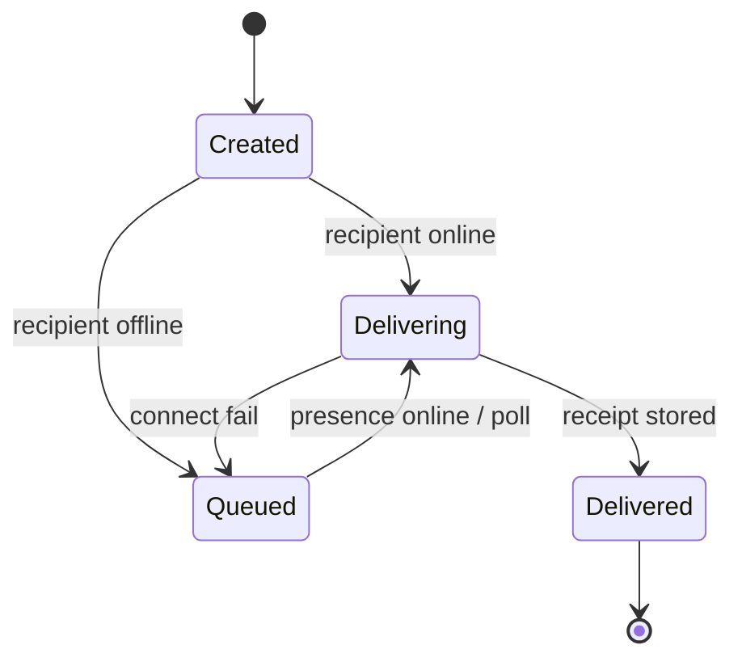
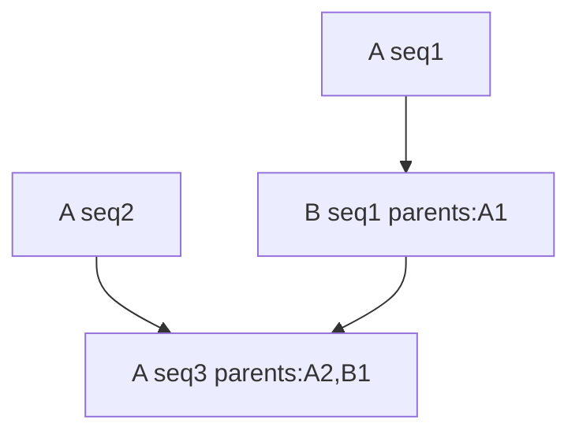

# Messaging

## Properties of private messages

- end-to-end encrypted
- signed
- immutable
- locally stored
- queued on sender while undelivered
- retried when recipient online
- deduplicated by message ID
- acknowledged as delivered after recipient storage

No read receipts. No editing. No remote deletion.

## Sender-side offline queue

If recipient offline:

1. sender encrypts and signs
2. sender stores encrypted outbound envelope locally
3. sender checks recipient presence periodically
4. default retry interval: **30 minutes**
5. immediate retry on presence-online events
6. when online: signalling → secure session → transmit
7. recipient stores and ACKs
8. sender marks delivered; drops retry obligation

Encrypted outbound may remain in local history after delivery.

**Sender device must be online** for undelivered messages to deliver.

The TypeScript client persists every non-direct-only DM in
`<storagePath>/outbound.db` before attempting transmission, including when the
relay socket is online. Reuse that storage path and identity after restart.
Retries resume on authentication, authenticated relay presence events, and the
30-minute poll; there is no silent retry-count cutoff. A socket write does not
remove the obligation: only a signature-verified recipient receipt does.
Signed duplicate envelopes receive another receipt without another visible DM.
The TUI labels unacknowledged messages **queued on this device**, not delivered
or failed merely because the peer is offline. First contact still requires a
previously published, identity-proven recipient prekey bundle.



## Retry scheduling

```text
on message creation:
  check current presence immediately

if offline:
  schedule retry for 30 minutes

when a presence-online event arrives:
  retry immediately

if connection fails:
  retry with bounded exponential backoff
  retain the normal 30-minute presence poll ceiling
```

Battery-aware clients may defer background retries per OS constraints.

## Delivery semantics

Not literal exactly-once network transmission.

Effectively-once user-visible delivery via:

- globally unique message IDs
- retransmission until ACK
- recipient deduplication
- idempotent storage
- stable acknowledgement records

Duplicate packets must never create duplicate visible messages.

## Delivered receipt

Means: **at least one currently authenticated online recipient device has
stored the message locally.**

Per AD-7, senders fan out only to devices with live presence; offline own
devices catch up via history sync, not sender fanout.

Does **not** mean opened, read, accepted for execution or completed. It is a
certified device's signed storage assertion, not independent proof of its disk.

```text
delivery_receipt {
  version: 2
  senderIdentityId
  recipientIdentityId
  messageId
  recipientDeviceId
  storedAt
  auth: { rootPublicKey, certificate, signature }
}
```

The existing identity-auth domain `dm.delivery_receipt` covers all fields.
The recipient identity must derive from the proof's root key; that root must
certify the signing device and its matching device ID. The intended sender
must be this sender, and the message and recipient must match a pending X3DH
queue item. Only then does the client emit `verified_delivery_receipt` and
discharge the queue obligation. `delivery_receipt` is an untrusted raw event.

Certificate validity is checked on arrival; `storedAt` must lie within its
validity window and cannot exceed the existing five-minute clock tolerance.
An expired or invalid receipt leaves the message pending. Retrying a duplicate
lets the recipient acknowledge it with its renewed certificate without
displaying it twice. Duplicate valid receipts do not emit delivery twice.

This replaces unversioned root-signed receipts without a legacy fallback.
Closed-pilot clients must upgrade together; old receipts cannot clear the
new sender queue. No root private key or remote prekey lookup is needed to
acknowledge or verify delivery. UI may hide recipient device ID.

## Envelopes

Outer envelope:

```text
message_envelope {
  protocol_version
  message_id
  conversation_id
  sender_identity_id
  sender_device_id
  recipient_identity_id
  sender_sequence
  parent_ids[]
  created_at
  ciphertext
  signature
}
```

Sender signs canonical encoding excluding the signature field.

Encrypted payload:

```text
message_payload {
  content_type
  text
  reply_to_message_id?
  attachment_offer?
  client_metadata?
}
```

Initial release: plain text + attachment offers.

## Ordering

No single global canonical order. Use causal + per-sender ordering.

### Per-sender sequence

Monotonic sequence per conversation per sender: `1, 2, 3, ...`

### Causal references

Optional `parent_ids[]` = messages visible to sender at composition time.

### Stable local display order

1. causal dependencies
2. sender sequence
3. creation timestamp
4. message ID as deterministic tie-breaker

Timestamps are not fully trusted.



## Contact initiation

DM may start from: username search, shared link, mutual, shared group/room,
random match.

Receiver may accept, ignore, or block.

Unknown-user messages begin as **requests**:

- limited pending requests per account
- no attachments before acceptance
- no repeated request after rejection
- sender reputation gating for high volume
