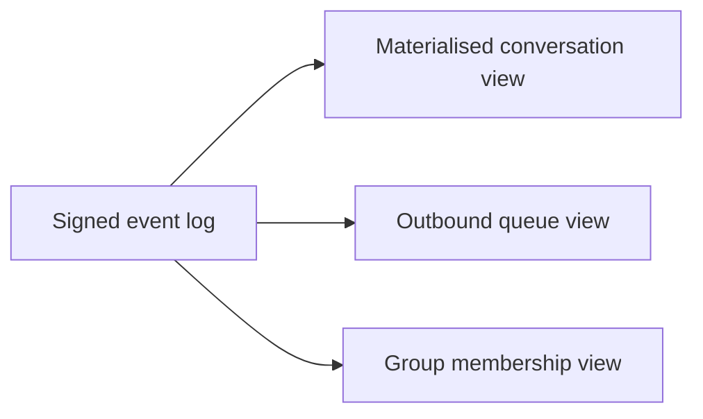

# Local storage

Client uses an encrypted local database.

## Storage groups

```text
account
wallet references
passkey metadata
device certificate
contacts
conversations
messages
outbound queue
delivery receipts
group state
room subscriptions
reputation state
block lists
attachment metadata
presence cache
```

## At-rest encryption

Local databases should be encrypted with keys protected by OS secure storage
where available.

### AD-25: restart-safe delegated device storage (2026-10-30)

**Decision:** the closed pilot uses a host-supplied 32-byte unlock key for
authenticated encryption of private device state. The key is never written
alongside the database. Root private keys are not stored by the recovered
client. OS keychain and secret-provider integration belongs to the later
identity-daemon piece, not this storage implementation.

**Reason:** device keys, X3DH prekeys and ratchets must survive process death
without becoming plaintext SQLite blobs. The unlock key must come from
outside the state it protects. Missing keys, incorrect keys, damaged rows,
unsupported databases and incomplete provisioning fail closed. None of these
conditions creates an empty replacement store or enables plaintext fallback.

**Limits:** a compromised host can obtain the unlock key and read all device
state. Encryption does not protect a running process, hide database size or
record names, provide revocation, or detect rollback to an older complete
database snapshot. Do not restore old ratchet snapshots and resume the same
device: restoring old key state can reuse keys. Backups and rollback-safe
recovery are not implemented. Losing the unlock key loses access to the
stored history and device keys; a wallet does not decrypt this database.

### Recovery API and transaction boundaries

`createPersistentClient(config, credentials)` explicitly provisions a new
device store. `openPersistentClient(config)` only opens an existing one.
`config.unlockKey` must contain the host-supplied key. Initial credentials
contain a principal public key, a device signing key pair and its signed
certificate, never a principal private key. Renewed certificates are saved
before replacing the in-memory certificate. Signing-key rotation is rejected
in persistent mode: existing prekeys depend on that key. Explicitly provision
a new device rather than silently overwriting its authority. No legacy database or unknown
ratchet provenance is automatically migrated: use a separate device directory
for explicit provisioning and preserve old files for a separately reviewed
migration.

The client acquires a SQLite OS-managed exclusive lock on the canonical
device directory before reading secrets. A second cooperating writer fails
immediately. `disconnect()` retains ownership for reconnects; `close()` stops
the client and releases ownership permanently. Process death releases the
lock without PID files, stale-lock deletion or timeout-based stealing. Do not
delete `device.lock`, move an open directory or put it on a filesystem that
does not enforce SQLite locking. This is local-disk storage, not a distributed
lock.

One SQLite transaction commits each receive's ratchet advance, consumed
one-time prekey and inbox entry. Another commits each send's ratchet advance
and immutable encrypted outbox envelope before transmission. A failed write
rolls back the entire transition, including the in-memory view: persistent
clients do not use the process-global ratchet or private-prekey caches.
Recovery errors are reported rather than interpreted as absent sessions.

Only verified receipt v2 proofs from #10 mark queued envelopes delivered;
the proof and verification timestamp are committed with the delivered state.
Expired receipts cannot newly discharge the queue. A receipt verified while
valid remains historical delivery evidence after restart. Pending envelopes
retain their original bytes and retry after authenticated reconnect. Stored
prekeys are republished rather than regenerated on reconnect.

`client.inbox()` reads the durable decrypted transport inbox after restart.
Callbacks are process-local notifications, not an exactly-once execution
contract. Inbox storage precedes delivery acknowledgement; application
handler failure does not undo delivery. Retried packets receive a fresh
acknowledgement without another callback or inbox insertion.

The legacy `new NexnetClient(...)` and `SessionStore` APIs remain development
facilities, not this recovery contract. Persistent mode rejects custom queues
and direct-only sends because they bypass its atomic outbox. Existing
non-persistent clients are not silently upgraded.

### Agent-pilot implementation boundary

#9 proves certificate renewal and transport reception. #10 adds verified
root-free receipts. This piece adds encrypted device recovery, transactional
DM state and single-writer ownership, not grant enforcement or a usable
delegated daemon. Revocation remains #4; 11-hour certificates plus renewal
limit exposure but do not revoke a compromised device immediately. Queued
and delivered are transport states. Accepted, completed and failed execution
remain the later agent layer's responsibility.

## Append-only event log

Conversation and group state are signed append-only events.

Materialised views may be generated for UI performance.



## Outbound queue schema

```text
outbound_queue_item {
  message_id
  recipient_identity
  encrypted_envelope
  created_at
  last_attempt_at
  next_attempt_at
  attempt_count
  delivery_state
}
```

Process restarts must not lose queued messages.
